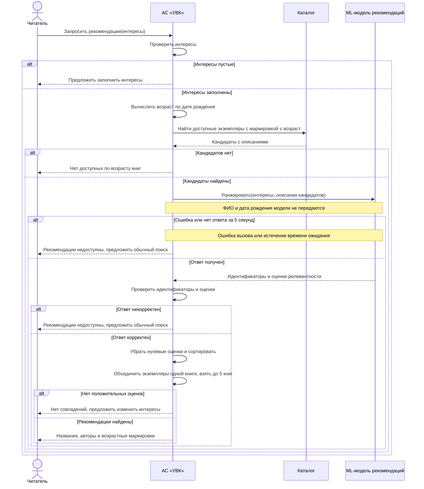
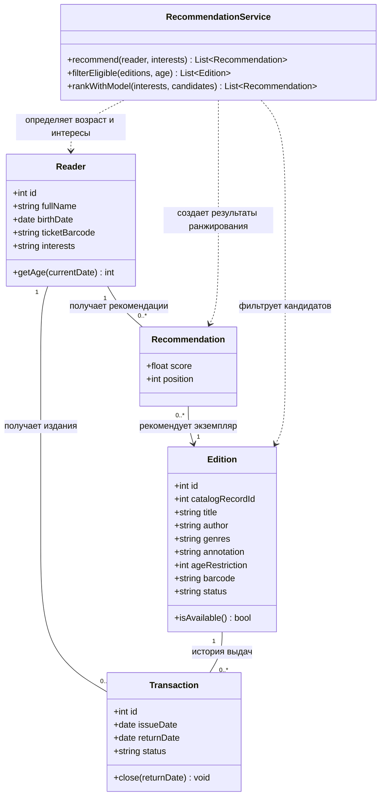

# Диаграммы

Диаграммы показывают взаимодействие компонентов и основные сущности АС «УВК» в соответствии с [требованиями](requirements.md).

## Диаграмма последовательности

Диаграмма показывает **UC-01 «Получение рекомендаций книг»**. Возрастной фильтр применяется до обращения к ML-модели; выдача и резервирование не входят в этот сценарий.

Обычный поиск при отказе модели также применяет возрастной фильтр.

## Диаграмма классов

Диаграмма отражает учет читателей и экземпляров, операции выдачи и формирование рекомендаций.

- **Reader** — читатель с датой рождения и интересами; возраст вычисляется, а не хранится отдельным устаревающим полем.
- **Edition** — отдельный физический экземпляр издания с уникальным штрихкодом, возрастной маркировкой и статусом. Несколько экземпляров одной книги представлены разными объектами с общим `catalogRecordId`; в списке рекомендаций остается только один из них.
- **Transaction** — операция выдачи одного экземпляра одному читателю; дата возврата отсутствует до возврата. У экземпляра может быть много исторических выдач, но не более одной незакрытой одновременно.
- **Recommendation** — временный результат подбора: один читатель, один экземпляр, оценка релевантности и позиция в списке. Для одного запроса формируется от нуля до пяти результатов; хранение истории рекомендаций не требуется.
- **RecommendationService** — сервис подбора: применяет строгие фильтры и вызывает ML-модель для ранжирования оставшихся кандидатов. Взаимодействие с ML-моделью показано на диаграмме последовательности.

Связи выдачи и рекомендации не зависят друг от друга: рекомендация не означает, что экземпляр уже выдан или зарезервирован.
